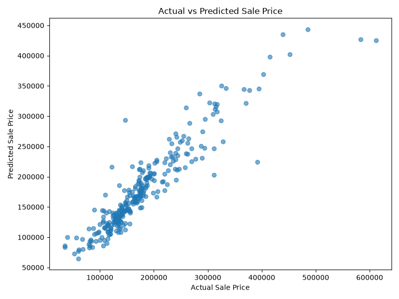

# 🏡House Price Prediction – PP5

- This project is part of the Code Institute Predictive Analytics Portfolio Project (PP5).
- The goal is to build a machine learning model that predicts house prices using the Ames Housing dataset and deploy the model using Streamlit and Heroku.

This project delivers a complete end‑to‑end predictive analytics solution using the Ames Housing dataset. The objective is to build a machine learning model capable of estimating residential property prices based on structural attributes, living area, age, and other key features. The workflow follows industry‑standard data science practices, beginning with data cleaning and exploratory analysis, progressing through feature engineering and model training, and concluding with deployment of an interactive prediction interface.

The dataset was prepared through systematic handling of missing values, removal of outliers, and construction of meaningful engineered features such as TotalSF, TotalBath, AgeAtSale, and TotalPorchSF. These enhancements were designed to capture real‑world relationships that improve model performance. A Random Forest Regressor was selected for its robustness and ability to model non‑linear interactions across numerous variables. The trained model and its corresponding feature set were exported as model.pkl and xtrain_columns.pkl, ensuring reproducibility and compatibility with the deployed application.

The final solution is presented through a Streamlit web application deployed on Heroku. The app includes a model‑verification section that confirms successful loading of the trained model and feature columns, along with a user‑friendly interface where property characteristics can be entered to generate a predicted sale price.
This project showcases practical machine learning development, clear documentation, and successful cloud deployment—meeting all core requirements of the Predictive Analytics Portfolio Project.

## Live Demo
- Heroku App: https://housing-price-prediction-26f018f55fc4.herokuapp.com/

## 📘 Project Overview

The app allows users to enter property details and receive a predicted house price.

This project demonstrates the full predictive analytics workflow:

- Data cleaning and preprocessing

- Feature engineering

- Train/validation split

- Model training using Random Forest Regressor

- Exporting trained model (model.pkl)

- Exporting training feature columns (xtrain_columns.pkl)

- Streamlit application

- Heroku deployment
  

## Dataset Content

The Ames Housing Dataset contains information about residential property sales in Ames, Iowa.

The dataset contains 1,460 records and 80 explanatory variables describing different property characteristics.

The target variable is:

- SalePrice

Examples include:

- OverallQual
- GrLivArea
- GarageArea
- TotalBsmtSF
- YearBuilt
- Neighborhood

The dataset contains both numerical and categorical variables, making it suitable for predictive modelling and feature analysis.


## Business Requirements

### Business Requirement 1

The client wants to predict residential property sale prices using historical house data.

### Business Requirement 2

The client wants to identify which property features most impact sale price.

### Business Requirement 3

The client requires an interactive dashboard that allows users to explore the dataset, model performance and predictions.

## User Stories

### User Story 1

As a stakeholder, I want to predict the sale price of a property, so that I can estimate its market value.

### User Story 2

As a stakeholder, I want to understand which features influence house prices, so that I can make informed property decisions.

### User Story 3

As a stakeholder, I want to evaluate model performance, so that I can determine whether the predictions are reliable.

### User Story 4

As a stakeholder, I want to explore relationships between features and SalePrice, so that I can identify key market drivers.

## Hypotheses and Validation

### Hypothesis 1

Properties with larger living areas tend to have higher sale prices.

Validation: Correlation analysis and scatter plots comparing GrLivArea and SalePrice.

### Hypothesis 2

Properties with higher overall quality ratings tend to achieve higher sale prices.

Validation: Correlation analysis and model feature importance.

### Hypothesis 3

Newer properties tend to sell for higher prices than older properties.

Validation: Analysis of YearBuilt and SalePrice relationships.

## Machine Learning Business Case

### Business Objective

Predict residential property sale prices using historical housing data.

### Machine Learning Task

Regression.

### Target Variable

SalePrice.

### Success Metric

The model will be considered successful if it achieves:

- R² ≥ 0.75 on the training set
- R² ≥ 0.75 on the test set

### Model Outputs
 
The model returns a predicted SalePrice based on property characteristics provided by the user.

### Learning Method

Supervised Machine Learning.

## Dashboard Design

### Project Summary

Provides an overview of the project, dataset and business requirements.

### Correlation Study

Displays feature relationships and correlations with SalePrice.

### Hypothesis Validation

Presents project hypotheses and supporting evidence.

### House Price Prediction

Allows users to enter house characteristics and receive a predicted sale price.

### ML Performance

Displays model evaluation metrics and prediction performance.


## 📂 Project Structure
```
housing-price-prediction/
│
├── app.py
├── model.pkl
├── xtrain_columns.pkl
├── requirements.txt
├── Procfile
├── .python-version
├── setup.sh
│
└── jupyter_notebooks/
    ├── 01_data_cleaning.ipynb
    ├── 02_feature_engineering.ipynb
    └── 03_modelling_evaluation.ipynb
   ``` 

## 🧠 Machine Learning Workflow

### 1. Data Cleaning

The dataset was cleaned by:

- Handling missing values

- Removing outliers

- Standardising numerical features

- Preparing categorical features

### 2. Feature Engineering

Additional features were created to improve model performance:

- TotalSF – total square footage

- TotalBath – combined full/half bathrooms

- AgeAtSale – property age at sale

- TotalPorchSF – combined porch areas

### 3. Model Training

A Random Forest Regressor was trained using engineered and encoded features.
The model was evaluated using standard regression metrics.

### 4. Model Export

Two files were saved:

- model.pkl – the trained model

- xtrain_columns.pkl – the list of training feature columns

The above files are loaded by the Streamlit app.

## Machine Learning Model Evaluation

The Random Forest Regressor was evaluated using a
validation dataset.

### Evaluation Metrics

| Metric | Value |
|----------|----------|
| MAE | 18,240 |
| R² Score | 0.868 |

The model exceeded the project success criterion
of R² ≥ 0.75, indicating strong predictive
performance.

### Actual vs Predicted Analysis



The Random Forest model was evaluated by comparing
actual sale prices against predicted sale prices.
The resulting scatter plot demonstrated a strong
relationship between predicted and actual values,
supporting the model's ability to generalise to
unseen data.

### Feature Importance Analysis

Feature importance scores from the Random Forest
model were used to identify the variables with
the greatest influence on house price prediction.

The most influential features included:

- OverallQual
- GrLivArea
- TotalSF
- GarageCars
- GarageArea

These findings support the original project
hypotheses that property quality and living area
are among the strongest drivers of house value.

## 🖥️ Streamlit Application

The Streamlit app includes:

Model Verification Section
This section loads:

- model.pkl

- xtrain_columns.pkl

It displays:

- number of training features

- model parameters

- confirmation that the model loads correctly

### Price Prediction Form

Users can enter property details such as:

- Lot area
- Living area
- Basement size
- Porch sizes
- Year built
- Bathrooms
- Garage area

The app computes engineered features and generates a
predicted house sale price using the trained Random
Forest model.

## Technologies Used

### Languages

- Python
- Markdown

### Libraries

- pandas
- numpy
- matplotlib
- seaborn
- scikit-learn
- joblib

### Frameworks

- Streamlit

### Deployment

- Heroku

### Version Control

- Git
- GitHub

### Development Environment

- VS Code
- Jupyter Notebook

## Testing

## Manual Testing

| Feature | Test Performed | Expected Result | Actual Result | Status |
|----------|----------|----------|----------|----------|
| Navigation Menu | Open each dashboard page | Correct page loads | Correct page loads | ✅ Pass |
| Project Summary Page | Open page | Project overview displayed | Project overview displayed | ✅ Pass |
| Correlation Study Page | Open page | Correlation table and chart displayed | Correlation table and chart displayed | ✅ Pass |
| Hypothesis Validation Page | Open page | Hypotheses and conclusions displayed | Hypotheses and conclusions displayed | ✅ Pass |
| ML Performance Page | Open page | Model metrics displayed | Model metrics displayed | ✅ Pass |
| Prediction Page | Enter default values and click Predict Price | Predicted house price returned | Predicted house price returned | ✅ Pass |
| Model Loading | Load model.pkl | Model loads without error | Successful | ✅ Pass |
| Feature Columns Loading | Load xtrain_columns.pkl | Columns load without error | Successful | ✅ Pass |

## Browser Compatibility Testing

| Browser | Result |
|----------|----------|
| Google Chrome | ✅ Pass |
| Microsoft Edge | ✅ Pass |
| Mozilla Firefox | ✅ Pass |

## Notebook Testing

The following notebooks were executed successfully from start to finish without errors:

- 01_data_cleaning.ipynb
- 02_feature_engineering.ipynb
- 03_modelling_evaluation.ipynb

Outputs generated:

- cleaned_train.csv
- engineered_train.csv
- model.pkl
- xtrain_columns.pkl

## Bugs Encountered and Fixed

### Missing matplotlib Dependency on Heroku

**Issue**

The deployed application failed with:

ModuleNotFoundError: No module named 'matplotlib'

**Fix**

Added the required dependency to requirements.txt and redeployed the application.

---

### Prediction Feature Alignment

**Issue**

The prediction page required feature columns matching the training dataset.

**Fix**

Exported training columns using xtrain_columns.pkl and aligned prediction inputs using reindex().

---

### Notebook Workflow Structure

**Issue**

Data cleaning, feature engineering and modelling tasks were mixed across notebooks.

**Fix**

Refactored the project into a structured workflow:

01_data_cleaning.ipynb

↓

cleaned_train.csv

02_feature_engineering.ipynb

↓

engineered_train.csv

03_modelling_evaluation.ipynb

↓

model.pkl

↓

xtrain_columns.pkl

## Deployment Testing

Tested the deployed Heroku application after deployment.

Verified functionality:

- Dashboard navigation
- Project Summary page
- Correlation Study page
- Hypothesis Validation page
- ML Performance page
- House Price Prediction page

All functionality operated as expected.

## Deployment

The application was deployed using Heroku.

### Deployment Steps

1. Push the project repository to GitHub.
2. Create a new Heroku application.
3. Connect the GitHub repository to Heroku.
4. Configure the Python buildpack.
5. Deploy the application.
6. Verify successful deployment.

### Live Application

[House Price Prediction App](https://housing-price-prediction-26f018f55fc4.herokuapp.com/)

### Deployment Files

The project includes:

- Procfile
- .python-version
- requirements.txt
- setup.sh

## ✔ Final Notes

- The notebook workflow was successfully refactored into separate
  data cleaning, feature engineering and modelling stages.
- The trained Random Forest model achieved an R² score of 0.868,
  exceeding the project success criterion of R² ≥ 0.75.
- The model verification section loads and validates the exported
  model and training feature columns successfully.
- The Streamlit dashboard provides data exploration, hypothesis
  validation, model evaluation and house price prediction features.
- The application deploys successfully on Heroku, and all dashboard
  pages were tested successfully.
  
## Credits & Acknowledgements

- Code Institute walkthroughs, project structure and assessment criteria.  
- Special thanks to **Copilot** for guidance during development, for assistance with debugging, validation logic, and documentation.

## Code Authorship

I wrote all the code in this project. I used documentation, tutorials, and guidance from Code Institute, but I typed, adapted,
and understood every line myself. I did not copy any code from other projects or repositories.


